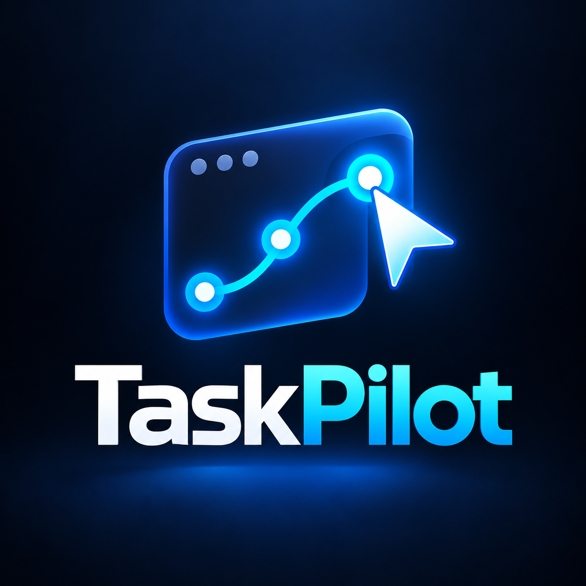

# TaskPilot



**TaskPilot — Automatización visual y configurable para Windows, sin necesidad de escribir scripts.**

TaskPilot es una aplicación de escritorio para Windows orientada a automatizar interacciones repetitivas con interfaces gráficas. Permite configurar clicks, pulsaciones de teclado, movimientos del cursor, rutas grabadas y acciones basadas en detección visual sin exigir al usuario escribir código.

## Continuidad del proyecto

TaskPilot es la continuación directa de **AutoInputR**. El nombre AutoInputR se conserva para las versiones históricas publicadas hasta **v1.3.0**. El nuevo nombre, paquete Python e identidad visual comienzan durante el desarrollo de **v1.4.0**.

Esto significa que los tags y Releases históricos no se reescriben: AutoInputR v1.3.0 sigue siendo la última versión pública anterior al rebranding.

## Estado actual

**Desarrollo:** TaskPilot v1.4.0-dev
**Última versión pública:** AutoInputR v1.3.0

El instalador público vigente continúa disponible en GitHub Releases:

[Descargar AutoInputR v1.3.0](https://github.com/RobDev512/AutoInputR-Desktop/releases/download/v1.3.0/AutoInputR_Setup_v1.3.0.exe)

## Propósito del proyecto

TaskPilot busca reducir la distancia entre una tarea repetitiva y una automatización funcional. Su enfoque es ofrecer una herramienta local, comprensible y extensible para automatizaciones de escritorio de complejidad baja o media.

El proyecto se desarrolla como **proyecto personal de software y automatización con enfoque de portafolio**, con potencial para evolucionar hacia una herramienta general de automatización de escritorio. Los juegos pueden ser uno de sus escenarios de uso, pero no constituyen el propósito principal del producto.

Consulta [PRODUCT.md](PRODUCT.md) para la definición completa de producto.

## Características actuales

### Clicker
- Clicks automáticos con intervalos configurables.
- Click simple o doble.
- Botón izquierdo, derecho o central.
- Posición actual del cursor o coordenadas fijas.
- Repetición limitada o indefinida.
- Modo Turbo.

### KeyPresser
- Repetición automática de una tecla seleccionada.
- Intervalos configurables.
- Repetición limitada o indefinida.
- Hotkeys globales.
- Modo Turbo.

### Mover
- Movimiento automático del cursor dentro de una zona seleccionada.
- Diferentes patrones de movimiento.
- Desplazamiento suave.
- Velocidad configurable.
- Clicks periódicos para evitar inactividad.

### Ruta
- Grabación de movimientos del cursor.
- Registro de clicks durante la grabación.
- Reproducción de rutas.
- Velocidad de reproducción configurable.
- Grabación mientras otra aplicación permanece enfocada.
- HUD visual durante la grabación.

### Rastreador
- Selección de una zona de búsqueda.
- Captura de una imagen objetivo.
- Rastreo visual mediante plantillas.
- Movimiento suave hacia el objetivo detectado.
- Coincidencia mínima configurable.
- Micro movimientos para activar elementos mediante hover.
- Clicks periódicos configurables.

### Ventana objetivo
- Selector de ventana objetivo.
- Identificación por título, proceso y clase.
- Pausa automática al perder el foco.
- Reanudación automática al recuperarlo.
- Protección aplicada a Clicker, KeyPresser, Mover, Ruta y Rastreador.
- Persistencia de la selección entre ejecuciones.

### Funciones generales
- Hotkeys globales configurables.
- Configuración persistente.
- Opción para mantener la aplicación encima.
- Integración con la bandeja del sistema.
- Interfaz desarrollada con CustomTkinter.

## Casos de uso

TaskPilot está pensado para automatizaciones sencillas y locales, por ejemplo:

- Repetir interacciones de mouse o teclado.
- Reproducir secuencias para pruebas o demostraciones.
- Automatizar pequeños flujos en programas que no ofrecen una API adecuada.
- Ejecutar acciones condicionadas por una ventana objetivo.
- Experimentar con automatización visual y reconocimiento por plantilla.
- Crear rutinas personales repetitivas de bajo riesgo.

El uso en juegos es secundario y debe limitarse a contextos donde la automatización esté permitida por sus reglas o términos de servicio.

## Estructura del proyecto

```text
TaskPilot.py                  Punto de entrada

assets/branding/             Identidad visual
docs/                        Documentación del proyecto
packaging/                   Compilación e instalador
requirements/                Dependencias de ejecución y desarrollo
tests/                       Pruebas automáticas
data/                        Datos locales generados (ignorado por Git)

taskpilot/
├── app.py                    Ventana principal y coordinación
├── core/
│   ├── config.py
│   ├── hotkeys.py
│   ├── resources.py
│   └── target_window.py
├── modules/
│   ├── clicker.py
│   ├── keypresser.py
│   ├── mover.py
│   ├── ruta.py
│   └── rastreador.py
├── services/
│   ├── input_backend.py
│   ├── tray.py
│   ├── vision.py
│   └── windows.py
└── ui/
    └── dialogs/
        ├── settings.py
        └── window_selector.py
```

Consulta [ARCHITECTURE.md](ARCHITECTURE.md), [BRANDING.md](BRANDING.md), [ROADMAP.md](ROADMAP.md) y [CHANGELOG.md](CHANGELOG.md).

## Desarrollo

```powershell
python -m pip install -r .\requirements\runtime.txt
python .\TaskPilot.py
```

Validación rápida:

```powershell
python -m compileall -q .\TaskPilot.py .\taskpilot
python -m unittest discover -s .\tests -v
```

Las instrucciones completas están en [DEVELOPMENT.md](DEVELOPMENT.md).

## Empaquetado

```text
packaging/build.ps1
packaging/TaskPilot.iss
```

Durante el desarrollo `APP_VERSION` puede usar el sufijo `-dev`. Antes de un Release debe alinearse con la versión numérica de Inno Setup.

## Uso responsable

TaskPilot es una herramienta de automatización general. El usuario es responsable de comprobar que su utilización esté permitida por las reglas, términos y condiciones de las aplicaciones, juegos o servicios donde la ejecute.

## Código fuente y derechos

El código fuente de este repositorio es públicamente visible. **Eso no implica una licencia de código abierto.** Mientras el repositorio no incluya una licencia que conceda permisos adicionales, se mantienen reservados los derechos correspondientes.

Se permite descargar, instalar y utilizar gratuitamente la versión oficial compilada para uso personal. Sin autorización previa del autor, no se autoriza redistribuir versiones modificadas, comercializar TaskPilot, presentarlo como una creación propia ni reutilizar su identidad visual en productos derivados, salvo los derechos que otorgue expresamente la legislación aplicable.

TaskPilot se proporciona tal cual, sin garantías.

## Autor

Desarrollado por Robert.

Copyright © 2026 Robert. Todos los derechos reservados.
